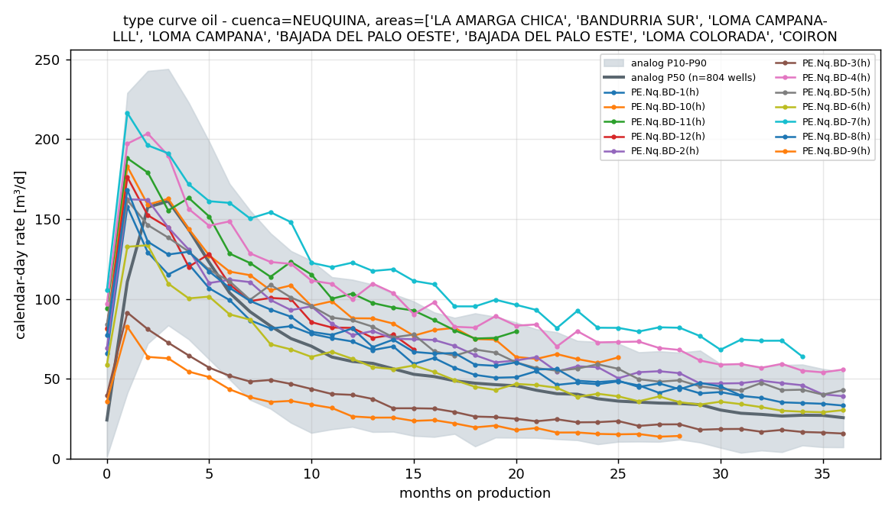

# capiv

**Benchmark your wells against every other well in Argentina.**

Argentina's Secretaría de Energía publishes the monthly oil, gas and water production
of *every* well in the country ("Capítulo IV", Res. SE 319/93). `capiv` loads that
dataset into a local DuckDB, loads your company's wells in the same schema, and gives
a Claude agent a closed set of engineering comparisons to run on them: type curves,
per-well percentiles, operator and area rankings, GOR / water-cut drift. The agent
decides *which* comparison to run and with *which* analog set; it never writes SQL.

```
you>  ¿Mis pozos están sobre la curva tipo de los bloques vecinos de Vaca Muerta?

  → company_summary()
  → list_areas(cuenca='NEUQUINA', formacion='vaca muerta', sub_tipo_recurso='SHALE',
               vintage_from='2022-01', vintage_to='2025-06', min_wells=10)
  → type_curve(areas=['LA AMARGA CHICA', 'BANDURRIA SUR', 'LOMA CAMPANA-LLL', ...],
               vintage_from='2022-01', vintage_to='2025-06', months=36)
  → well_benchmark(areas=[...], metric='cum12')

En conjunto sí: 10 de los 12 pozos caen en o por encima de la P50 de los análogos
en el acumulado de 12 meses (804 pozos shale oil, vintage 2022-01..2025-06).
Dos están claramente por debajo:

| Pozo  | Primera prod. | cum12 (m³) | Percentil | vs P50 |
|-------|---------------|-----------:|----------:|-------:|
| BD-9  | 2024-05       |     17.308 |        P5 |  −54 % |
| BD-3  | 2022-09       |     20.873 |        P8 |  −44 % |

Arrancan muy por debajo (82–91 m³/d de pico contra ~161 m³/d de la P50) y se
mantienen 35–60 % abajo toda su vida: el problema viene desde el inicio, lo que
apunta a terminación o landing, no a una declinación más rápida...

[5 turns, 33 s, cost $0.67]
```



> Status: v0.1. Works end to end on the real dataset; the company in the demo is
> synthetic. See *Limitations*.

## Why

Most "LLM over your database" demos let the model write SQL. For production
benchmarking that is the wrong trade: the hard part is not the `SELECT`, it is the
normalisation (months-on-production alignment, vintage windows, calendar-day rates,
"has this well reached 12 months before you compute cum12"). A model improvising SQL
over a 40-column table gets one of those subtly wrong and the answer *looks* right.

So the comparisons are code, with tests, and the model's job is the one it is good
at: understand the question, pick the comparison, pick a defensible analog set,
read the tables and the chart, and explain the result like a reservoir engineer.
[DESIGN.md](DESIGN.md) has the full reasoning.

## Install

```bash
git clone https://github.com/LucasBurriel/capiv && cd capiv
pip install -e ".[dev]"
python -m pytest            # 30 tests, no network, no API key
```

Python 3.11+. Dependencies: `duckdb`, `pandas`, `matplotlib`, `claude-agent-sdk`.
The agent needs Claude credentials: either `ANTHROPIC_API_KEY` in the environment or
a Claude Code login (`claude auth login`); the bundled Claude Code CLI picks up
whichever is present. Everything except `capiv ask` / `capiv chat` runs offline.

## Quick start

```bash
capiv download                       # ~150 MB: all unconventional wells, 2006-2026 -> ~/.capiv/capiv.duckdb
capiv make-demo my_company.csv       # 12 synthetic wells of "Petrolera Ejemplo S.A." (or use your own CSV)
capiv load-company my_company.csv
capiv status

capiv ask "Which of my wells are under-performers vs the Bandurria Sur / La Amarga Chica type curve?"
capiv ask "How do we rank against the other Vaca Muerta operators for wells started since 2022?"
capiv ask "Which areas are delivering the best wells in the 2023-2025 vintage?"
capiv chat                           # multi-turn
```

Charts land in `./capiv_out/`. Without a model, the same comparisons run directly:

```bash
capiv run list_areas        --args '{"cuenca":"NEUQUINA","formacion":"vaca muerta","sub_tipo_recurso":"SHALE","vintage_from":"2022-01","min_wells":30}'
capiv run type_curve        --args '{"areas":["BANDURRIA SUR","LA AMARGA CHICA"],"sub_tipo_recurso":"SHALE","vintage_from":"2022-01","vintage_to":"2025-06"}'
capiv run well_benchmark    --args '{"areas":["BANDURRIA SUR","LA AMARGA CHICA"],"vintage_from":"2022-01","metric":"cum12"}'
capiv run operator_benchmark --args '{"cuenca":"NEUQUINA","formacion":"vaca muerta","sub_tipo_recurso":"SHALE","vintage_from":"2022-01","min_wells":10}'
capiv run area_ranking      --args '{"cuenca":"NEUQUINA","formacion":"vaca muerta","sub_tipo_recurso":"SHALE","vintage_from":"2023-01","top":12}'
capiv run gor_water_cut     --args '{"areas":["BANDURRIA SUR","LA AMARGA CHICA"],"vintage_from":"2022-01"}'
```

A full transcript of three agent runs is in [examples/demo-session.md](examples/demo-session.md).

## Your data

A CSV with **the same column names as Capítulo IV**, i.e. the file operators already
send to the regulator every month:

| column | required | unit |
|---|---|---|
| `sigla` | yes | well name |
| `anio`, `mes` | yes | |
| `prod_pet` | yes | m³ / month |
| `prod_gas` | yes | thousand m³ / month |
| `prod_agua` | yes | m³ / month |
| `idpozo`, `empresa`, `tef`, `areayacimiento`, `cuenca`, `formacion`, `sub_tipo_recurso`, `tipopozo`, `profundidad` | no | as in the public file |

`capiv schema` prints this. [examples/my_company.csv](examples/my_company.csv) is the
synthetic demo company: 12 invented Vaca Muerta wells of an invented operator in an
invented block, calibrated to look like 2022-2025 shale-oil wells (Arps hyperbolic
declines, a couple of deliberate under-performers, one water problem). Regenerate it
with `capiv make-demo`.

## The tools the agent has

| tool | answers | returns |
|---|---|---|
| `company_summary` | what do I have? | one row per company well |
| `list_areas` | which public areas match this filter and have enough wells? | areas, operators, wells, P50 cum12 |
| `type_curve` | are my wells on the curve? | P10/P50/P90 calendar-day rate by month-on-production + every company well; chart |
| `well_benchmark` | which wells under-perform, by how much? | each company well's `peak_rate` / `cum6` / `cum12` / `decline12` with its percentile in the analog set; chart |
| `operator_benchmark` | how do we rank vs the neighbours? | operators ranked by median cum12 per well, company inserted as a row; chart |
| `area_ranking` | where are the best wells being drilled? | areas ranked by median cum12 for a vintage window; chart |
| `gor_water_cut` | is my GOR / water cut drifting? | median GOR and water cut by MOP, analogs vs company; chart |

Every tool takes the same **analog filter**: `cuenca`, `areas[]`, `formacion`,
`sub_tipo_recurso` (SHALE / TIGHT), `tipo_de_recurso`, `vintage_from` / `vintage_to`
(first-production window, `YYYY-MM`), `exclude_empresa`, and `fluid` (oil / gas).
Arguments are validated against a JSON schema before anything touches DuckDB, and
the SQL underneath is fixed templates with bound parameters.

Definitions (see [DESIGN.md](DESIGN.md) §3): MOP 0 = first month with production of
the fluid; rates are `volume / calendar days`; cum6 / cum12 only for wells that
reached that age; `decline12 = rate@MOP12 / peak`; GOR in m³/m³; P90 = 90 % of
wells are below.

## Architecture

```
 capiv/
   data.py       download (CKAN resource ids) · load CSVs into DuckDB · load company CSV · dedup
   schema.py     company CSV contract (same names as Capítulo IV)
   queries.py    the closed set of comparisons: fixed SQL templates + bound params -> DataFrames
   plots.py      matplotlib charts -> PNG
   tools.py      JSON-schema'd tool registry over queries+plots (also used by `capiv run`)
   agent.py      Claude Agent SDK: in-process MCP server with the 7 tools, system prompt, CLI loop
   synthetic.py  Arps-based synthetic wells (demo CSV and test fixtures)
   cli.py        capiv download | load | load-company | status | schema | make-demo | run | ask | chat
```

The agent is built with the [Claude Agent SDK](https://code.claude.com/docs/en/agent-sdk)
(Python): model `claude-opus-5-5`, adaptive thinking, the seven tools registered as an
in-process MCP server (`@tool` + `create_sdk_mcp_server`), **built-in tools disabled**
(`tools=[]`) and user settings not loaded (`setting_sources=[]`), so the agent has
exactly these seven capabilities and nothing else. Tool results carry the markdown
table plus the PNG as an image block, so the model sees the chart it just produced.
`--max-turns`, `--max-budget-usd`, `--effort` and `--model` are exposed on the CLI.

## The dataset

*Producción de petróleo y gas por pozo (Capítulo IV)* -
<https://datos.energia.gob.ar/dataset/produccion-de-petroleo-y-gas-por-pozo>,
licence CC-BY 4.0, updated monthly (the 2026 file had data to September 2026 on
2026-10-30, with first-production registers going back to 2006).

| resource | size | what |
|---|---|---|
| `Producción de Pozos de Gas y Petróleo No Convencional` | ~150 MB | all unconventional wells (SHALE / TIGHT), all years. **Default download.** |
| `Producción de Pozos de Gas y Petróleo - <year>` (2006..2026) | 240-330 MB each | every well, one file per year. `capiv download --year 2024` |
| `... (DDJJ abiertas y cerradas)` variants | same | include not-yet-closed monthly declarations; not used |
| `Capítulo IV - Pozos` | 34 MB | well register with coordinates, depth, drilling dates (not loaded in v0.1) |

Columns in the production files (40): `idempresa, empresa, idpozo, sigla, anio, mes,
prod_pet [m³], prod_gas [thousand m³], prod_agua [m³], iny_agua, iny_gas, iny_co2,
iny_otro, tef [days], vida_util, tipoextraccion, tipoestado, tipopozo
(Petrolífero / Gasífero / ...), formprod, formacion, profundidad, idareapermisoconcesion,
areapermisoconcesion, idareayacimiento, areayacimiento, cuenca, provincia,
coordenadax/y, tipo_de_recurso (CONVENCIONAL / NO CONVENCIONAL), sub_tipo_recurso
(SHALE / TIGHT), proyecto, clasificacion, subclasificacion, fecha_data, fechaingreso,
rectificado, habilitado, idusuario, observaciones`. `capiv` keeps 25 of them.

The unconventional file alone is ~431 k rows / 5.2 k wells; the Vaca Muerta shale-oil
analog set for the 2022-2025 vintage is ~800 wells, which is what makes the
percentiles meaningful.

## Limitations

* **No completion data.** The public file has no lateral length, stage count or
  proppant. A short-lateral well will look like an under-performer. Treat the
  percentiles as "production per well", not "completion quality".
* **Calendar-day rates**, not `tef`-normalised. Shut-ins lower a well's rank.
* **Vintage is the only design proxy.** Always pass `vintage_from` / `vintage_to`.
* The first-production date is computed from the loaded rows: if you load only
  `--year 2024`, every well looks like it started in 2024. The unconventional file
  covers all years so this is only a problem for conventional work; load several years.
* Small analog sets (< 20 wells) give noisy P10/P90; the agent is told to say so.
* The demo company is synthetic. Nothing in this repository is a real operator's
  private data; the only operator names that appear are those in the public dataset.

## Development

```bash
python -m pytest -q         # fixtures generate a tiny fake "public" table; no download needed
capiv run type_curve --args '{...}'   # exercise a comparison without the model
```

Adding a comparison = a function in `queries.py` + a `ToolSpec` in `tools.py` + a
test. That is a code review, not a prompt edit, and it is the point.

## License

MIT. The Capítulo IV data is CC-BY 4.0, Secretaría de Energía de la Nación Argentina.
