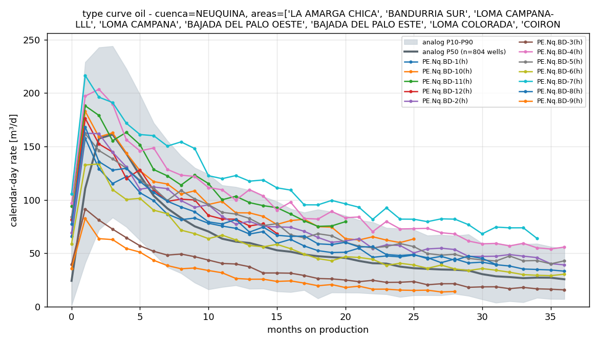
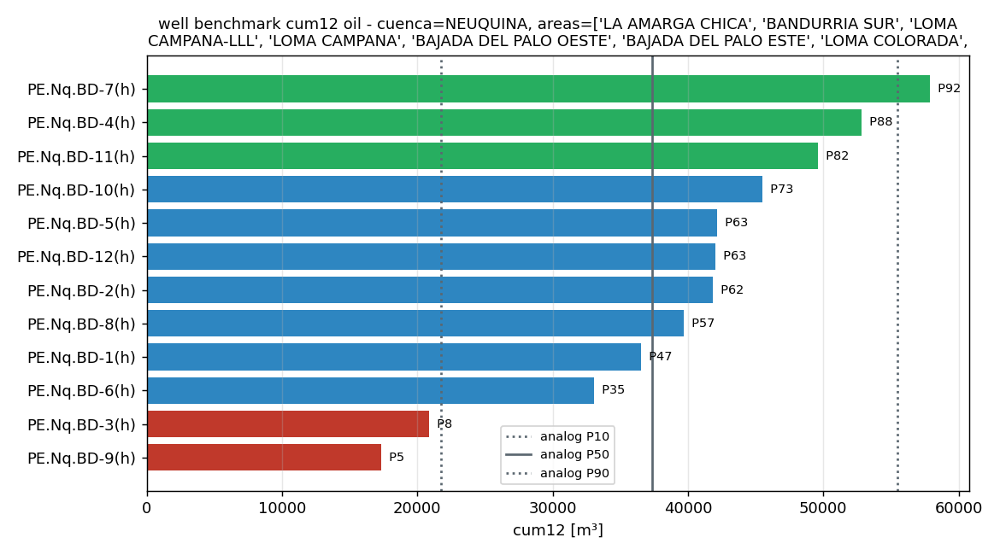
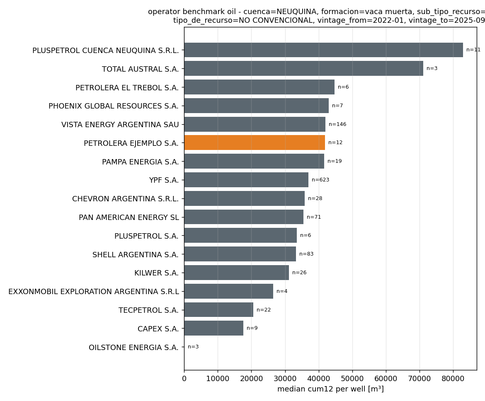
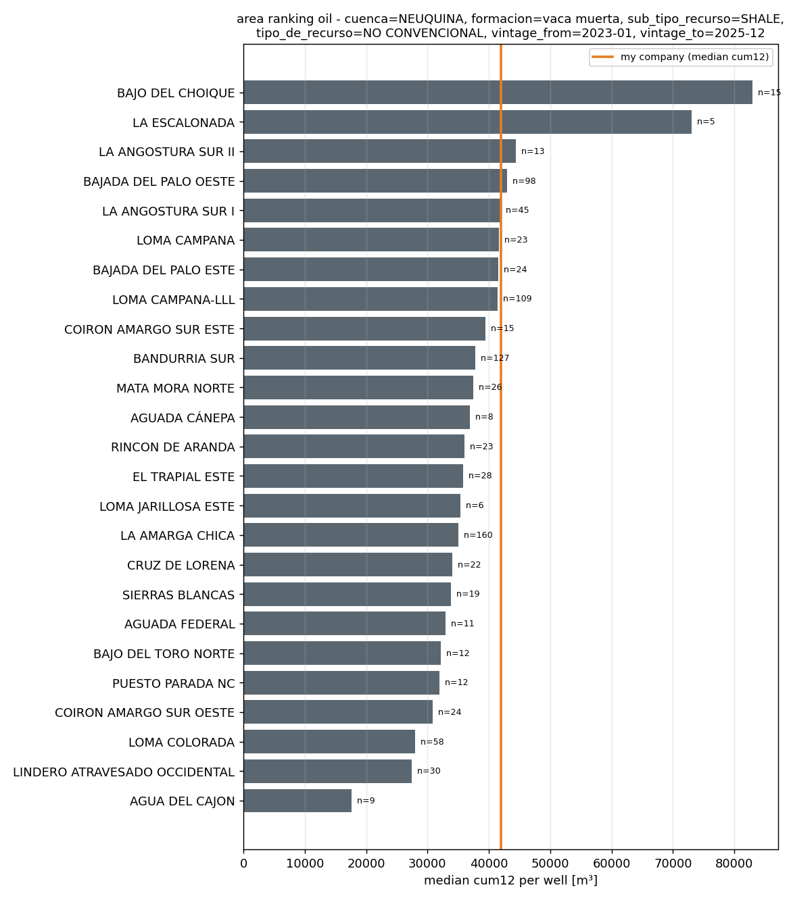

# Demo session

Three runs of `capiv ask` on 2026-10-30, against the real unconventional Capítulo IV
file (431 k rows, data to 2026-09) and the synthetic company in
[`my_company.csv`](my_company.csv). Model `claude-opus-5-5`, adaptive thinking,
`--max-budget-usd 3`. Lines starting with `→` are the tool calls the agent chose
(echoed to stderr by the CLI); everything else is the model's answer, verbatim.

---

## 1. ¿Mis pozos están sobre la curva tipo de los bloques vecinos de Vaca Muerta? Identificá cuáles están por debajo y cuánto.

```
  → company_summary()
Los 12 pozos son de Vaca Muerta shale (petrolíferos) en BLOQUE DEMO, con primera producción entre 2022-03 y 2025-06. Ahora busco las áreas análogas para esa misma ventana de vintage.
  → list_areas(cuenca='NEUQUINA', formacion='vaca muerta', sub_tipo_recurso='SHALE', fluid='oil', vintage_from='2022-01', vintage_to='2025-06', min_wells=10, limit=40)
  → type_curve(cuenca='NEUQUINA', formacion='vaca muerta', sub_tipo_recurso='SHALE', fluid='oil', vintage_from='2022-01', vintage_to='2025-06', areas=['LA AMARGA CHICA', 'BANDURRIA SUR', 'LOMA CAMPANA-LLL', 'LOMA CAMPANA', 'BAJADA DEL PALO OESTE', 'BAJADA DEL PALO ESTE', 'LOMA COLORADA', 'COIRON AMARGO SUR OESTE', 'CRUZ DE LORENA', 'SIERRAS BLANCAS', 'LA ANGOSTURA SUR I', 'MATA MORA NORTE', 'LINDERO ATRAVESADO OCCIDENTAL'], months=36)
  → well_benchmark(cuenca='NEUQUINA', formacion='vaca muerta', sub_tipo_recurso='SHALE', fluid='oil', vintage_from='2022-01', vintage_to='2025-06', areas=[...same 13 areas...], metric='cum12')
```

En conjunto sí están sobre la curva: 10 de los 12 pozos caen en o por encima de la P50 de los análogos en el acumulado de 12 meses, y la mediana del bloque queda en torno a P60. Hay dos pozos claramente por debajo, **BD-9** y **BD-3**, y un tercero algo flojo, **BD-6**.

**Contra qué comparé.** BLOQUE DEMO no está en los datos públicos, así que no sé dónde queda ni cuáles son sus vecinos reales. Usé 13 bloques del núcleo petrolero de Vaca Muerta: La Amarga Chica, Bandurria Sur, Loma Campana y Loma Campana-LLL, Bajada del Palo Oeste y Este, Loma Colorada, Coirón Amargo Sur Oeste, Cruz de Lorena, Sierras Blancas, La Angostura Sur I, Mata Mora Norte y Lindero Atravesado Occidental. Son 804 pozos de petróleo shale de la cuenca Neuquina que empezaron a producir entre 2022-01 y 2025-06. Si me pasás los bloques que realmente lindan con el tuyo, repito el análisis solo con esos.

**Rango de los análogos (acumulado 12 meses):** P10 = 21.785 m³, P50 = 37.355 m³, P90 = 55.487 m³.

**Pozos por debajo de la curva:**

| Pozo | Primera producción | Acum. 12 meses (m³) | Percentil | vs P50 | Caudal vs P50 (meses 3 / 6 / 12 / 24) |
|---|---|---|---|---|---|
| **BD-9** | 2024-05 | 17.308 | P5 | **−54%** | −61% / −58% / −57% / −59% |
| **BD-3** | 2022-09 | 20.873 | P8 | **−44%** | −55% / −50% / −34% / −39% |
| BD-6 | 2023-07 | 33.061 | P35 | −11% | −32% / −13% / +3% / +8% |
| BD-1 | 2022-03 | 36.512 | P47 | −2% | −28% / −4% / +21% / +24% |

**Cómo leerlo:**
- **BD-9 y BD-3** arrancan muy por debajo (caudal máximo de 82–91 m³/d contra unos 161 m³/d de la P50) y se mantienen 35–60% abajo durante toda su vida. No es que declinen más rápido: el problema viene desde el inicio, lo que apunta a la terminación, al landing o a la interferencia con pozos vecinos. Ninguno de los dos produce agua fuera de lo normal.
- **BD-6** arranca 32% abajo y después alcanza la P50, pero acumula 89.340 m³ de agua contra 66.599 m³ de petróleo, un corte de agua de alrededor de 57%. El resto de los pozos está en 15–20%. Conviene revisarlo: puede ser comunicación con agua o un problema de flowback.
- BD-1 y, en menor grado, BD-5, BD-8, BD-2 y BD-12 arrancan bajo la P50 pero declinan más lento y quedan por encima desde el mes 6–12. Esa forma de declinación es mejor que la de los análogos.
- Los mejores son **BD-7** (P92, +55%), **BD-4** (P88, +41%) y **BD-11** (P82, +33%).

**Limitaciones:**
- Los caudales son por día calendario, sin corregir por días efectivos de producción, y los datos públicos no traen el largo de rama, así que un pozo con rama más corta va a parecer peor de lo que es.
- BD-12 tiene apenas 15 meses de historia y BD-11, 20: su acumulado de 12 meses ya está definido, pero no hay historia larga para confirmar la tendencia.
- El grupo de análogos es grande (804 pozos), pero mezcla operadores con diseños distintos.

Si querés, puedo correr `gor_water_cut` para confirmar lo de BD-6 o `operator_benchmark` para ver dónde queda tu compañía frente a cada operador.

Gráficos: `capiv_out/type_curve_oil_-_...png`, `capiv_out/well_benchmark_cum12_oil_-_...png`

`[5 turns, 33s, cost $0.667]`




---

## 2. How does my company rank against the other Vaca Muerta shale-oil operators for wells started since 2022? Then check whether my GOR and water cut drift away from the analogs.

```
I'll start by checking what wells the company has.
  → company_summary()
  → operator_benchmark(cuenca='NEUQUINA', formacion='vaca muerta', tipo_de_recurso='NO CONVENCIONAL', sub_tipo_recurso='SHALE', fluid='oil', vintage_from='2022-01', vintage_to='2025-09', exclude_empresa='PETROLERA EJEMPLO S.A.')
  → gor_water_cut(cuenca='NEUQUINA', formacion='vaca muerta', tipo_de_recurso='NO CONVENCIONAL', sub_tipo_recurso='SHALE', vintage_from='2022-01', vintage_to='2025-09', exclude_empresa='PETROLERA EJEMPLO S.A.', months=36)
```

## Vaca Muerta shale oil, wells started 2022-01 to 2025-09

**Analog set:** Neuquina basin, Vaca Muerta, NO CONVENCIONAL / SHALE oil wells, first production 2022-01 to 2025-09, with your company excluded. That gives about 1,070 analog wells, which matches your 12 wells (first production 2022-03 to 2025-06).

### 1. Ranking against other operators (median cum12 per well)

You rank **6th of 17 operators**, with a median cum12 of **41,924 m³**. That is effectively tied with Vista (42,025) and Pampa (41,696), and **13% above YPF** (36,988, 623 wells). The two operators above you with much higher medians, Pluspetrol Cuenca Neuquina (82,938) and Total Austral (71,073), have only 11 and 3 wells, so treat their medians with caution. Among operators with 19 or more wells, you are in the top group.

| Operator | Wells | Peak (m³/d) | cum12 (m³) | decline12 | GOR | Water cut |
|---|---|---|---|---|---|---|
| Vista | 146 | 226.8 | 42,025 | 0.31 | 100.5 | 0.23 |
| **Petrolera Ejemplo** | **12** | **165.4** | **41,924** | **0.48** | **110.4** | **0.13** |
| Pampa | 19 | 193.3 | 41,696 | 0.34 | 78.5 | 0.32 |
| YPF | 623 | 185.4 | 36,988 | 0.37 | 135.4 | 0.25 |
| PAE | 71 | 161.8 | 35,509 | 0.37 | 68.9 | 0.22 |
| Shell | 83 | 190.0 | 33,272 | 0.27 | 88.7 | 0.12 |

Your wells get there in a different way from the others. Your median **peak rate is low** (165 m³/d, against 185 to 227 for the large operators). But your wells **hold their rate better**: at month 12 they still produce 48% of peak, against 31 to 37% for the others. That is why your cum12 ends up level with Vista's.

### 2. GOR and water cut over time (medians by month on production)

**GOR:** You track the analogs closely up to about month 12 (120.5 vs 121.3 m³/m³). After that you pull away steadily:

| Month on production | You | Analogs | Difference |
|---|---|---|---|
| 18 | 129.5 | 121.8 | +6% |
| 24 | 142.6 | 123.8 | +15% |
| 30 | 153.3 | 123.0 | +25% |
| 36 | 155.6 | 128.7 | +21% |

The analog GOR barely moves after month 12; yours keeps rising. In a shale well this usually means pressure near the wellbore has dropped below the bubble point. It could be linked to how you manage drawdown (choke or artificial-lift timing). That would also fit your flatter early decline, since those wells may be producing harder later in life.

**Water cut:** There are two separate things here.
- **Months 0–6:** The analogs start very wet (0.67 at month 0, falling to 0.14 by month 6) because they are producing back frac water. Yours start at about **0.10** and show almost no flowback water. That is unusual. Check whether your dataset leaves out flowback water or reports it differently.
- **From month 8 on, the curves diverge:** Analogs hold steady at 0.10–0.13. Yours **rise without stopping**, from 0.13 to 0.18 (month 18), 0.20 (month 24) and **0.26 (month 36)**. By month 36 that is about **2.4 times the analog median**. BD-6 alone has 89,340 m³ of water, about four times its siblings, but this is a median, so most of your older wells are getting wetter, not just that one.

### Caveats
- Late in well life your sample is small: 10 wells at month 24 and only 6 at month 36, so the later medians are noisy.
- Rates are per calendar day, not adjusted for downtime.
- The public data has no lateral length or frac size, so differences in well design can't be separated from differences in rock quality.

### Suggested next step
Run `well_benchmark` on cum12 and decline12 to find which wells are below P25. From the cumulative totals, BD-3 (44k m³ in 49 months) and BD-9 (27k m³ in 29 months) look weak, and BD-6 should be checked for water.

**Charts:**
- `capiv_out\operator_benchmark_oil_-_cuenca_NEUQUINA_formacion_vaca_muerta_sub_tipo_recurso_.png`
- `capiv_out\GOR_and_water_cut_-_cuenca_NEUQUINA_formacion_vaca_muerta_sub_tipo_recurso_SHALE.png`

`[4 turns, 29s, cost $0.594]`

---

## 3. Which Neuquina shale-oil areas are delivering the best wells in the 2023-2025 vintage, and where would my block sit in that ranking?

```
  → company_summary()
  → area_ranking(cuenca='NEUQUINA', formacion='vaca muerta', sub_tipo_recurso='SHALE', tipo_de_recurso='NO CONVENCIONAL', fluid='oil', vintage_from='2023-01', vintage_to='2025-12', top=25, min_wells=5)
  → well_benchmark(cuenca='NEUQUINA', formacion='vaca muerta', sub_tipo_recurso='SHALE', tipo_de_recurso='NO CONVENCIONAL', fluid='oil', vintage_from='2023-01', vintage_to='2025-12', metric='cum12')
```

Your block (BLOQUE DEMO) would rank **about 5th of 25** Neuquina Vaca Muerta shale-oil areas for 2023–2025 wells. Its median first-12-month cumulative oil (cum12) is **~42,000 m³ per well**. That puts it just behind Bajada del Palo Oeste (42,967 m³) and level with the main Loma Campana, La Angostura Sur I and Bajada del Palo Este group. It is **about 14% above the median of all 902 wells** in the comparison set (36,984 m³). Only two areas, Bajo del Choique and La Escalonada, are clearly better, and both have few wells.

**Comparison set:** Neuquina basin, Vaca Muerta formation, unconventional shale, oil wells, first production between 2023-01 and 2025-12. Areas need at least 5 wells to be ranked.

**Top of the ranking (median cum12 per well, m³):**

| # | Area | Wells | Median cum12 | Median peak rate (m³/d) |
|---|---|---|---|---|
| 1 | Bajo del Choique | 15 | 82,938 | 369 |
| 2 | La Escalonada | 5 | 73,012 | 271 |
| 3 | La Angostura Sur II | 13 | 44,404 | 216 |
| 4 | Bajada del Palo Oeste | 98 | 42,967 | 227 |
| — | **BLOQUE DEMO (your 2023–25 wells, n=9)** | 9 | **42,152** | — |
| — | *BLOQUE DEMO (all 12 wells, as plotted)* | 12 | *41,924* | — |
| 5 | La Angostura Sur I | 45 | 41,802 | 229 |
| 6–8 | Loma Campana / Bajada del Palo Este / Loma Campana-LLL | 23 / 24 / 109 | 41,677 / 41,520 / 41,469 | 193–214 |
| … | Bandurria Sur, La Amarga Chica | 127 / 160 | 37,833 / 35,039 | ~182–188 |
| 25 | Agua del Cajón | 9 | 17,615 | 103 |

**What's behind your number:**
- **Very uneven wells.** Three wells are in the top quarter of the comparison set: BD-7 (57,900 m³, 90th percentile), BD-4 (52,810 m³, 86th) and BD-11 (49,580 m³, 81st). Two are in the bottom quarter: BD-9 (17,308 m³, 7th percentile, 53% below the comparison median) and BD-3 (20,873 m³, 11th). Bringing BD-9-type wells up to the median would move the block up more than improving the best wells.
- **BD-6 is worth checking.** Its cum12 is near the median (37th percentile), but its total water is 89,340 m³, roughly 4–5 times that of its sister wells. I can run a GOR and water-cut comparison next to see if this is a completion or water-breakthrough problem.
- **The orange line on the chart uses all 12 of your wells (41,924 m³)**, including three that started in 2022. Using only your nine 2023–2025 wells gives 42,152 m³. Either way the block lands in 5th place.

**Caveats:**
- **Small samples at the top.** Bajo del Choique has 15 wells and La Escalonada only 5, so their medians are not robust. Most areas in the ranking have fewer than 20 wells.
- **Not like-for-like completions.** The public data has no lateral length or stage count, so part of the gap between areas may come from well design rather than rock quality.
- **Rates are per calendar day**, not per producing day, so downtime counts against a well.
- **Your youngest well is just past 12 months.** BD-12 has 15 months of production, so its cum12 is defined but only just.

**Charts:**
- Area ranking: `C:\Users\Lucas\Desktop\Code\capiv\capiv_out\area_ranking_oil_-_cuenca_NEUQUINA_formacion_vaca_muerta_sub_tipo_recurso_SHALE_.png`
- Per-well percentiles: `C:\Users\Lucas\Desktop\Code\capiv\capiv_out\well_benchmark_cum12_oil_-_cuenca_NEUQUINA_formacion_vaca_muerta_sub_tipo_recurs.png`

`[4 turns, 25s, cost $0.544]`

---

Total for the three runs: 13 turns, about 90 s, $1.81.



